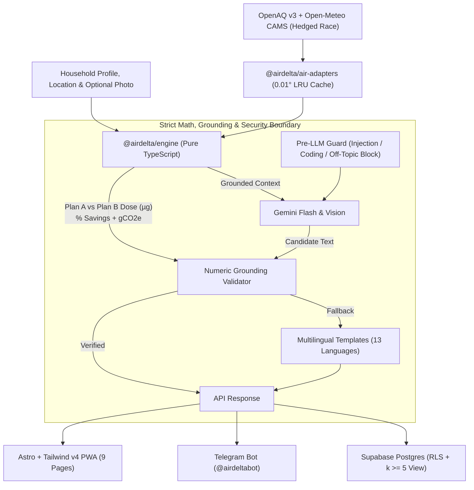

<div align="center">
  <a href="https://airdelta-web.onrender.com/?lang=en">
    
  </a>

  <h1>AirDelta (Δ)</h1>
  <p><strong>AI-Assisted Winter Smog &amp; Urban Air Action Engine</strong></p>
  <p>
    <a href="https://airdelta-web.onrender.com/?lang=en"><strong>Live Web App</strong></a> &nbsp;·&nbsp;
    <a href="https://airdelta-api.onrender.com/healthz"><strong>Live API</strong></a> &nbsp;·&nbsp;
    <a href="https://t.me/airdeltabot"><strong>Telegram Bot (@airdeltabot)</strong></a>
  </p>

  [](https://github.com/AJAYMYTH/AirDelta)
  [](https://github.com/AJAYMYTH/AirDelta/actions)
  [](https://github.com/AJAYMYTH/AirDelta)
  [](https://github.com/AJAYMYTH/AirDelta)
  [](https://github.com/AJAYMYTH/AirDelta)
  [](https://github.com/AJAYMYTH/AirDelta)
  [](https://github.com/AJAYMYTH/AirDelta)
</div>

<br />

> **Event:** PromptWars Hackathon Challenge 6 · **Chosen Vertical:** Public Health & Climate Resilience (Severe Winter Smog & Urban Air Pollution) · **Built by:** AJAYMYTH (Javali Ajayakumar)  
> **Core Thesis:** Everyone displays raw AQI numbers. Almost nobody answers: *"What should my family actually change today, how many micrograms of fine dust does it keep out of our lungs, what carbon does it cut, and how sure are you?"*

AirDelta computes a household's personalized **Plan A (normal day) vs. Plan B (optimized day)** inhaled $\text{PM}_{2.5}$ exposure difference and carbon emissions ledger using deterministic physical and biological exposure models (`@airdelta/engine`). Live monitoring runs a **hedged dual-adapter race & zero-failure fallback** across **OpenAQ v3 physical ground stations** (CPCB/DPCC/SPCB accuracy) and **Open-Meteo ECMWF CAMS** (low latency & global 72h dispersion forecasts), degrading cleanly to bounded LRU cache or an offline Nov 2026 Delhi smog replay fixture without ever failing an AQI lookup.

Google Gemini provides personalized narration, **multimodal room/smog photo analysis**, guarded interactive guidance, and translations across **all 12 major Indian regional languages + English**, verified by a deterministic **Numeric Grounding Validator** and pre-/post-LLM security guardrails.

---

## 🎯 Chosen Vertical, Approach & Logic

### 1. Chosen Vertical & Target Personas
- **Vertical:** Public Health & Climate Action — Urban Air Pollution Decision Engine for Families & Communities.
- **Primary Personas:**
  - **Families, Children, Teens & Seniors:** Need 60-second routine adjustments (morning walk timing, travel swap, kitchen exhaust) quantified in µg of inhaled $\text{PM}_{2.5}$.
  - **RWAs, Schools & Workplaces:** Need calm, CAQM GRAP-stage-aligned multilingual WhatsApp/Telegram advisories (`en`, `hi`, `bn`, `te`, `mr`, `ta`, `ur`, `gu`, `kn`, `or`, `ml`, `pa`, `as`) backed by $k \ge 5$ community anonymity.
  - **Daily Commuters:** Need exposure-vs-emissions trade-offs (e.g., open two-wheeler/car vs. Metro + fitted N95 mask, showing both lung-dose savings and $\text{gCO}_2\text{e}$ avoided).

### 2. Core Design Principles & Guardrails
1. **Strict Math Boundary (`LLM Explains, Code Computes`):** Gemini never calculates or invents pollution numbers, inhaled doses, or reduction percentages. Pure TypeScript (`@airdelta/engine`) executes every equation deterministically.
2. **Numeric Grounding Validator (`GroundingValidatorService`):** Every Gemini plan narration is scanned for numeric tokens. Any ungrounded number triggers instant replacement with verified regional templates (`TemplateFallbackService`).
3. **Domain-Guarded Multimodal AI Assistant (`/assistant` + Floating Drawer):**
   - Pre-LLM guardrails (`evaluateChatGuard`) reject prompt injections, jailbreaks, code generation (`python`, `javascript`, `sql`, etc.), and unrelated off-topic prompts before touching the LLM.
   - Injects the user's live location AQI, cleanest forecast airing window, age band (`child`/`teen`/`adult`/`senior`), commute mode, budget tier, kitchen exhaust setting, and computed Plan A vs Plan B deltas.
   - Supports **EXIF/GPS-stripped photo upload** for kitchen/room/smog visual analysis with capped server fallback budgets (`6.5 s` text / `10 s` image).
4. **Hedged Dual-Adapter Race (`AirDataService`):** Races OpenAQ v3 ground monitors (`2.2 s` accuracy budget) against Open-Meteo ECMWF CAMS, coalesces per `0.01°` (~1.1 km) cell, caps spatial/forecast caches via LRU eviction (`500` entries), and falls back cleanly to offline fixtures so AQI lookups never crash.
5. **Privacy by Minimization:** Coordinates snap to `0.01°` (~1.1 km) grid cells; uploaded photos are re-encoded on `<canvas>` to strip EXIF metadata; `PiiSanitizerService` redacts phone numbers, Aadhaar IDs, emails, addresses, and injection strings; Supabase enforces Row-Level Security (RLS), $k \ge 5$ group aggregation, and 30-day automatic pruning.

### 3. How the Solution Works
1. **Live Hyper-Local Air Sensing (`/`, `/map`):** AirDelta snaps the user's selected city or privacy-rounded GPS (`0.01°` ~ 1.1 km grid cell) and runs a hedged parallel race between OpenAQ v3 ground monitors and Open-Meteo ECMWF CAMS (`72h` forecast), computing US AQI, CPCB NAQI sub-indices, and the cleanest upcoming 3-hour airing window.
2. **Context-Aware Dose & Trade-Off Decisioning (`/plan`, `/indoor`):** Based on household age band (`child`, `teen`, `adult`, `senior`), caution sensitivity, commute mode (`two_wheeler`, `auto`, `bus`, `car`, `metro`, `walk`, `cycle`), budget tier (`none`/`low`/`medium`/`high`), and cooking exhaust availability, `@airdelta/engine` computes inhaled $\text{PM}_{2.5}$ dose (`Plan A` baseline vs. `Plan B` optimized day), indoor steady-state levels, and $\text{gCO}_2\text{e}$ carbon savings.
3. **Guarded Multimodal AI Assistant (`/assistant` + Floating Drawer):** Pre-LLM security filters (`evaluateChatGuard`) block prompt injections, coding prompts, and off-topic abuse. Valid clean-air questions—and optional EXIF-stripped room/kitchen photos—receive live-AQI + Plan-delta grounded context, Gemini narration, and numeric-grounding validation before rendering.
4. **Multilingual Community Action & Telegram Delivery (`/community`, `/replay`, `/method`, `@airdeltabot`):** Generates calm CAQM GRAP-stage WhatsApp/Telegram alerts in all 12 Indian regional languages + English, aggregates group savings only at $k \ge 5$ households for anonymity, and delivers 07:00 IST morning briefs and live location updates on Telegram.

### 4. Assumptions Made
- **Versioned Constants Registry (`2026-11-a`):** Minute ventilation rates ($VE$) across `child`, `teen`, `adult`, and `senior` follow US EPA Exposure Factors Handbook Chapter 6; microenvironment penetration factors ($F_{micro}$) follow EPIC India / Nazaroff aerosol research; transport emission factors follow CPCB & DMRC references; uncertainty intervals propagate at $[0.80, 1.25] \times D$.
- **Indoor Mass-Balance Baseline:** Single-compartment steady-state model defaults to $V = 45\text{ m}^3$, air exchange $\lambda = 1.2\text{ h}^{-1}$, and deposition $k = 0.25\text{ h}^{-1}$ when custom room dimensions are not specified.
- **Station Freshness:** OpenAQ readings $\le 3\text{ hours}$ old carry `[Measured]`; older readings degrade to `[Modelled]`. Forecasts use Open-Meteo ECMWF CAMS (`72h` hourly horizon).

---

## 🏛️ System Architecture



### Four Evidence Badges on Every Number
- `[Measured]`: Physical ground monitor reading (CPCB / OpenAQ CAAQMS) within 25 km and $< 3$ hours old.
- `[Forecast]`: Open-Meteo / ECMWF CAMS hourly dispersion forecast.
- `[Modelled]`: Computed via microenvironment penetration, indoor mass-balance, or exposure equations.
- `[Assumed]`: Peer-reviewed constant from Registry `2026-11-a`.

---

## 📐 Mathematical Formulation

### 1. Inhaled Particulate Matter Dose ($D$)
$$D = \sum_{i=1}^{N} C_{seg, i} \times VE_{seg, i} \times \Delta t_{seg, i}$$
- $C_{seg, i} = C_{out}(t) \times F_{micro, i} \times (1 - \eta_{mask})$
- $F_{micro, i}$: unsealed home ($0.75$), two-wheeler ($1.15$), auto ($0.90$), bus ($0.85$), AC car ($0.30$), Metro ($0.25$).
- $VE_{seg, i}$: age- and exertion-specific minute ventilation rate ($\text{m}^3/\text{h}$) across `child`, `teen`, `adult`, and `senior`.

### 2. Indoor Single-Compartment Mass Balance
$$\frac{dC_{in}}{dt} = P \lambda C_{out} - \left( \lambda + k + \frac{\text{CADR}}{V} \right) C_{in} + \frac{S}{V}$$
Quantifies the impact of window airing timing, kitchen exhaust fans, weatherstripping, DIY Corsi-Rosenthal boxes, and HEPA purifiers.

### 3. Carbon Co-benefit Ledger
$$E_{\text{CO}_2\text{e}} = \sum_{j} d_{km, j} \times EF_{mode, j}$$
Computes $\text{gCO}_2\text{e}$ avoided when shifting congested petrol cars or two-wheelers to Metro or active micro-mobility.

---

## 📦 Monorepo Structure

```text
airdelta/
├── apps/
│   ├── web/               # Astro 5 + Tailwind CSS v4 PWA (9 static pages + floating chat widget)
│   └── api/               # Node.js + Hono REST API + Telegram Bot Webhook (Docker / Render)
├── packages/
│   ├── engine/            # Pure TypeScript dose, mass-balance & optimizer engine (Zero I/O)
│   ├── schemas/           # Shared Zod contracts, GRAP rules & multilingual advisory generator
│   ├── air-adapters/      # OpenAQ v3, Open-Meteo, Google AQ (off by default) & Replay adapters
│   ├── fix-library/       # Curated indoor mitigation database indexed by budget tier
│   └── i18n/              # Full UI & page localization across 12 Indian languages + English
├── evals/                 # End-to-end grounding, monotonicity & adversarial safety suite
├── fixtures/              # Nov 6–8, 2026 Delhi smog episode dataset (AQI 385, GRAP Stage III)
├── scripts/               # Production helpers (keep-warm.mjs, set-telegram-webhook.mjs, verify-env.mjs)
├── supabase/              # PostgreSQL schema, migrations, RLS policies, and seed data
├── .github/workflows/     # GitHub Actions CI (build, typecheck, and Vitest verification)
└── docs/                  # PRD, TRD, Impact-Methodology, Navigation-Plan
```

---

## 🌐 Application Pages (9-Page PWA)

| Page | Route | Capabilities |
| :--- | :--- | :--- |
| **Today Dashboard** | `/` | Live GPS or city AQI, pollutant breakdown, interactive airflow visualizer, cleanest window, CAQM GRAP stage, and WhatsApp share. |
| **Live AQI Map** | `/map` | Fullscreen interactive Leaflet map (Open-Meteo AQI), tap-anywhere inspection, browser geolocation, and 1-click plan generation. |
| **Daily Plan** | `/plan` | Plan A vs Plan B inhaled $\text{PM}_{2.5}$ comparison across all age groups (`child`/`teen`/`adult`/`senior`), interactive swap toggles, and $\text{gCO}_2\text{e}$ ledger. |
| **AI Chat & Vision** | `/assistant` | Dedicated personalized clean-air AI assistant with live location/lifestyle sidebar, EXIF-stripped photo analysis, Markdown rendering, and prompt guardrails. |
| **Room Check** | `/indoor` | Client-side EXIF-stripped room photo audit, confirmation checklist, steady-state indoor $\text{PM}_{2.5}$ forecast, and budget-filtered fixes. |
| **Share Alert** | `/community` | One-tap WhatsApp / Telegram RWA/school/workplace GRAP notice generator in 13 languages + $k \ge 5$ anonymous impact ledger. |
| **Smog Replay** | `/replay` | 24-hour interactive timeline scrubber replaying the Nov 6–8, 2026 Delhi smog episode with live dose accumulation. |
| **How It Works** | `/method` | Transparent exposure physics equations, versioned Constants Registry `2026-11-a`, and peer-reviewed source links. |
| **Settings & Privacy**| `/settings` | Instant 13-language switcher (including RTL Urdu), data source attributions, zero-PII JSON export, and local purge. |

---

## 🤖 Telegram Bot Channel (`@airdeltabot`)

Zero-install companion powered by `grammY` (`POST /webhooks/telegram` + `pnpm bot` local polling):
- `/start` — 60-second onboarding with one-tap **Share My Live Location** and quick city buttons.
- `/location` — Supports **Telegram Live Location** streaming (`edited_message:location` auto-updates AQI on grid change).
- `/today` — Live AQI snapshot, dominant pollutant, and cleanest airing window.
- `/plan` — Personalized Plan A vs Plan B savings + direct link to `https://airdelta-web.onrender.com/plan`.
- `/advisory` — Multilingual RWA/community WhatsApp/Telegram share card.
- `/lang` — Switch language (`en`, `hi`, `bn`, `te`, `ta`, `kn`, etc.).
- **Photo Audit** — Send any room/kitchen photo for instant source detection and a link to `/indoor`.
- **07:00 IST Morning Brief** — Scheduled brief generator at `POST /webhooks/telegram/jobs/morning-brief`.

---

## 🔌 REST API Endpoints

### 1. Air Quality & Forecast
```bash
curl "http://localhost:3000/v1/air?lat=28.61&lng=77.21&provider=auto"
curl "http://localhost:3000/v1/air/forecast?lat=28.61&lng=77.21"
curl "http://localhost:3000/v1/air/health"
```

### 2. Personalized Plan A vs Plan B
```bash
curl -X POST "http://localhost:3000/v1/plans" \
  -H "Content-Type: application/json" \
  -d '{
    "targetLang": "hi",
    "profile": {
      "cityCode": "DELHI",
      "gridCell": "28.61:77.21",
      "lang": "hi",
      "budgetBand": "low",
      "cooksIndoors": true,
      "hasExhaust": false,
      "hasPurifier": false,
      "members": [
        { "id": "m1", "ageBand": "adult", "cautionMode": false },
        { "id": "m2", "ageBand": "teen", "cautionMode": false }
      ],
      "routines": [
        { "id": "r1", "memberId": "m1", "kind": "commute", "mode": "two_wheeler", "startHour": 8, "durationMinutes": 45, "isIndoor": false, "maskUsed": false }
      ]
    }
  }'
```

### 3. Guarded Multimodal AI Chat (`/v1/chat`)
```bash
curl -X POST "http://localhost:3000/v1/chat" \
  -H "Content-Type: application/json" \
  -d '{
    "message": "Budget indoor air quality hacks for cooking smoke?",
    "context": { "cityCode": "DELHI", "ageBand": "adult", "commuteMode": "two_wheeler", "budgetBand": "low" }
  }'
```
*(Also accepts optional `imageBase64` and `mimeType` up to 6 MB for room/smog visual analysis.)*

### 4. Indoor Photo Audit (`/v1/indoor-audits`)
```bash
curl -X POST "http://localhost:3000/v1/indoor-audits" \
  -H "Content-Type: application/json" \
  -d '{
    "imageBase64": "data:image/jpeg;base64,...",
    "mimeType": "image/jpeg",
    "roomHint": "kitchen",
    "budgetBand": "low"
  }'
```

### 5. Community Advisories & $k \ge 5$ Impact
```bash
curl -X POST "http://localhost:3000/v1/advisories" \
  -H "Content-Type: application/json" \
  -d '{
    "audience": "rwa_residents",
    "lang": "hi",
    "gridCell": "28.61:77.21"
  }'

curl "http://localhost:3000/v1/advisories/groups/sec14-rwa/impact?memberCount=8"
```

### 6. Data Retention Purge Job
```bash
curl -X POST "http://localhost:3000/v1/jobs/retention-purge?days=30"
```

---

## 🧪 Testing, Security & Hardening

Automated via GitHub Actions in [.github/workflows/ci.yml](.github/workflows/ci.yml):

```bash
# Run all 67 tests across 13 test suites
pnpm test

# Typecheck all workspace packages and 25 Astro files (0 errors, 0 warnings, 0 hints)
pnpm typecheck

# Full monorepo production build
pnpm -r run build
```

- **Engine Monotonicity & Coverage:** Verified across 50 synthetic households, property-based fast-check invariants, and every combination of `ageBand` (`child`, `teen`, `adult`, `senior`) × `commuteMode`.
- **API & Input Security:** Security headers (`X-Content-Type-Options`, `X-Frame-Options`, `Referrer-Policy`, `Permissions-Policy`), route-scoped `bodyLimit` guards, WGS84 coordinate bounds checks, Zod validation, constant-time `crypto.timingSafeEqual` secret checks, and sanitized error responses.
- **Bounded Memory Usage:** LRU eviction (`maxCacheEntries: 500`) on spatial/forecast caches, bounded narration/in-memory stores (`500` records / `2000` events), and bounded Telegram chat preference maps.
- **PII & Injection Defense:** Strips phone numbers, Aadhaar IDs, emails, and addresses; blocks prompt injections, jailbreaks, coding requests, and off-topic abuse before LLM calls.

---

## 🛠️ Local Development & Deployment

```bash
# 1. Clone repository
git clone https://github.com/AJAYMYTH/AirDelta.git
cd AirDelta

# 2. Install dependencies
pnpm install

# 3. Configure environment variables
cp .env.example .env

# 4. Start backend API (http://localhost:3000)
pnpm --filter @airdelta/api run dev

# 5. Start web PWA (http://localhost:4321)
pnpm --filter @airdelta/web run dev
```

### Production Hosting & Operations
- **Render Blueprint ([render.yaml](render.yaml)) & Docker ([Dockerfile](Dockerfile)):** Runs `airdelta-api` (Node/Hono Docker container) and `airdelta-web` (Astro static site).
- **Cloudflare Workers Static Assets ([wrangler.jsonc](wrangler.jsonc)):** Ready for edge static deployment via `pnpm deploy:cf`.
- **Database ([supabase/](supabase/)):** PostgreSQL migrations (`init_airdelta.sql` + `grant_permissions.sql`) with RLS and `community_group_impact`.
- **Bot & Keep-Warm Utilities:** `pnpm bot:webhook https://<api-domain>` registers the Telegram webhook; `pnpm api:keepwarm:once` warms `/healthz` and `/v1/air` (complemented by external UptimeRobot monitoring).

---

## 📜 Citations & Research References
- **US EPA Exposure Factors Handbook (Chapter 6):** Age- and activity-specific breathing ventilation rates ($VE$).
- **Nazaroff, W. W. (2004):** Single-compartment indoor particle mass-balance dynamics.
- **EPIC India / University of Chicago (2025):** Residential envelope penetration factors in Indian buildings.
- **CPCB / CAQM:** National Air Quality Index (NAQI) breakpoints and Graded Response Action Plan (GRAP) stages.
- **Delhi Metro Rail Corporation (DMRC):** Electric rapid transit emission factors.

---

<p align="center">
  <b>AirDelta</b> · Built by <b>AJAYMYTH (Javali Ajayakumar)</b> for PromptWars Challenge 6 · Public Health &amp; Climate Resilience
</p>
