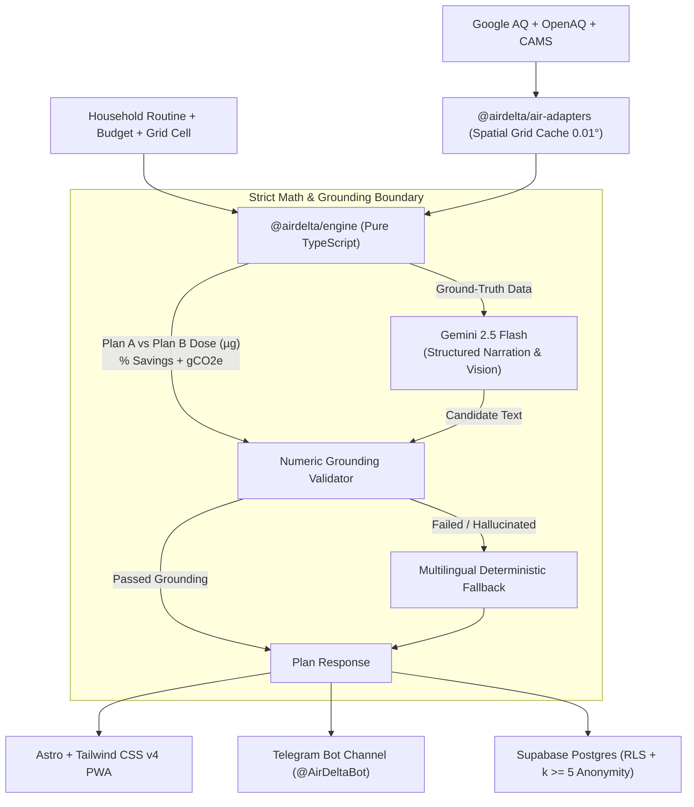

# AirDelta (Δ) — AI-Assisted Winter Smog Action Engine

[](https://github.com/AJAYMYTH/AirDelta)
[](https://github.com/AJAYMYTH/AirDelta)
[](https://github.com/AJAYMYTH/AirDelta)
[](https://github.com/AJAYMYTH/AirDelta)
[](https://github.com/AJAYMYTH/AirDelta)
[](https://github.com/AJAYMYTH/AirDelta)

> **Event:** PromptWars Hackathon · **Focus:** Severe Winter Smog & Urban Air Pollution in India  
> **Thesis:** Everyone displays the raw AQI. Almost nobody answers: *"What should my family actually change today, what does it save our lungs in toxic particles, and how sure are you?"*

AirDelta computes a household's personalized **Plan A (normal day) vs. Plan B (optimized day)** inhaled $\text{PM}_{2.5}$ dose difference and carbon emissions ledger using deterministic physical and biological exposure models (`@airdelta/engine`). Gemini is used exclusively for narrative explanation, contextual advice, indoor vision audits, and multilingual translation across **all 12 major Indian regional languages**, strictly verified by an automated numeric-grounding validator.

---

## 🏛️ Core Architectural Principles



1. **LLM Explains, Code Computes:**  
   No pollution reading, inhaled dose, savings percentage, or emissions metric is ever produced or hallucinated by the LLM. All calculations are executed deterministically by pure TypeScript modules (`@airdelta/engine`).
2. **Four Evidence Badges on Every Number:**  
   Every figure displayed to the user carries one of four explicit provenance badges:
   - `[Measured]`: Ground monitor reading (CPCB / OpenAQ CAAQMS) $\le$ 25 km away and $<$ 3 hours old.
   - `[Forecast]`: Hourly forecast from Google Air Quality API or ECMWF CAMS atmospheric models.
   - `[Modelled]`: Calculated via microenvironment penetration, indoor mass-balance, or transport factor equations.
   - `[Assumed]`: Documented literature constant from the versioned Constants Registry `2026-11-a`.
3. **Degrade, Never Lie:**  
   If upstream APIs, database, or LLM services fail, AirDelta falls back to pre-rendered deterministic templates with explicit `[Template]` or `[Stale]` markers—never invented values or false "safe" advice.
4. **Privacy by Minimization:**  
   No street addresses (only rounded ~1.1 km grid cells), no full names, no personal medical diagnoses (only generic age bands and a conservative "caution mode"). All user inputs are sanitized by `PiiSanitizerService`.
5. **Pan-India Multilingual Accessibility:**  
   Native localization across **12 Indian regional languages** (Hindi, Bengali, Telugu, Marathi, Tamil, Urdu, Gujarati, Kannada, Odia, Malayalam, Punjabi, Assamese) + English.

---

## 📐 Mathematical Formulation

### 1. Inhaled Particulate Matter Dose ($D$)
$$D = \sum_{i=1}^{N} C_{seg, i} \times VE_{seg, i} \times \Delta t_{seg, i}$$
Where:
- $C_{seg, i} = C_{out}(t) \times F_{micro, i} \times (1 - \eta_{mask})$
- $F_{micro, i}$ is the microenvironment penetration factor (e.g., unsealed home: $0.75$, 2-wheeler: $1.15$, Metro: $0.25$, sealed AC car: $0.30$).
- $VE_{seg, i}$ is the age- and exertion-specific minute ventilation rate from US EPA Exposure Factors Handbook ($m^3/h$).
- $\Delta t_{seg, i}$ is duration in hours.
- Uncertainty intervals are propagated at $[0.85, 1.15] \times D$.

### 2. Indoor Single-Compartment Mass Balance
$$\frac{dC_{in}}{dt} = P \lambda C_{out} - \left( \lambda + k + \frac{\text{CADR}}{V} \right) C_{in} + \frac{S}{V}$$
Models the impact of window ventilation timing, kitchen exhaust fans (removing $75\%$ of cooking emissions), and filtration CADR.

### 3. Carbon Co-benefit Ledger
$$E_{\text{CO}_2\text{e}} = \sum_{j} d_{km, j} \times EF_{mode, j}$$
Calculates emissions divergence (e.g. switching private petrol car or 2-wheeler to Delhi Metro or active transport).

---

## 📦 Monorepo Structure

```
airdelta/
├── apps/
│   ├── web/               # Astro + Tailwind CSS v4 PWA (Low-JS, mobile-first, 7 pages)
│   └── api/               # Node.js + Hono REST API + Telegram Bot Webhook
├── packages/
│   ├── engine/            # Pure TypeScript dose, mass-balance & optimizer engine (Zero I/O)
│   ├── schemas/           # Shared Zod schemas, TypeScript types, validation contracts
│   ├── air-adapters/      # Multi-provider air adapters (Google AQ, OpenAQ, Open-Meteo, Replay)
│   ├── fix-library/       # Curated indoor mitigation database indexed by budget band
│   └── i18n/              # 12+ Indian regional languages dictionary & localization engine
├── evals/                 # End-to-end evaluation suite for numeric grounding & safety
├── fixtures/              # Nov 6–8, 2026 Delhi severe smog episode dataset (AQI 385, GRAP Stage III)
├── supabase/              # PostgreSQL schema, migrations, RLS policies, and seed data
└── docs/                  # PRD, TRD, Impact-Methodology, Navigation-Plan
```

---

## 🌐 Application Pages (PWA)

| Page | Route | Description |
| :--- | :--- | :--- |
| **Today Dashboard** | `/` | Real-time CPCB AQI, pollutant breakdown, cleanest afternoon ventilation window, and active CAQM GRAP stage. |
| **Plan A vs Plan B** | `/plan` | Side-by-side comparison of normal vs optimized day: $-39.5\%$ inhaled dose reduction, transit carbon trade-offs, and assumptions audit. |
| **Indoor Photo Audit**| `/indoor` | Gemini Vision analysis of room photos (client-side EXIF stripping), detects unsealed cracks, exhaust fans, and calculates CADR targets. |
| **Community Advisories** | `/community` | One-tap WhatsApp / Telegram notice generator in regional languages + $k \ge 5$ anonymous community impact ledger. |
| **Smog Replay Studio** | `/replay` | Interactive 24-hour timeline scrubber replaying the Nov 6–8, 2026 Delhi severe inversion episode with live dose accumulation dynamics. |
| **Methodology** | `/method` | Transparent exposure science page with interactive versioned Constants Registry `2026-11-a` and academic citations. |
| **Settings & Privacy**| `/settings` | Switch between 12 Indian regional languages, zero-PII data export (JSON), and local storage purge. |

---

## 🤖 Telegram Bot Channel (`@AirDeltaBot`)

AirDelta provides a free, zero-cost conversational interface via `grammY` on the Telegram Bot API:
- `/start` — 60-second guided onboarding (city, grid cell, routine, budget band).
- `/today` — Instant ambient AQI, dominant pollutant, and cleanest window.
- `/plan` — Generate personalized Plan A vs Plan B and dose savings.
- `/indoor` — Submit a photo of your living room or kitchen for an instant CADR audit.
- `/advisory` — Generate a copy-paste WhatsApp notice for your RWA or apartment society.
- `/lang` — Switch bot language to any of the 12 Indian regional languages.
- **07:00 IST Morning Brief** — Proactive push notification triggered daily via scheduler endpoint `POST /webhooks/telegram/jobs/morning-brief`.

---

## 🗄️ Supabase Postgres Schema & Security

The database schema (`supabase/migrations/20261123000000_init_airdelta.sql`) implements:
1. **Row-Level Security (RLS):** Strict tenant isolation (`auth.uid() = owner`) across `households`, `members`, `routine_segments`, `plans`, and `actions`.
2. **$k \ge 5$ Anonymity View:** The `community_group_impact` view returns aggregated community statistics (PM2.5 saved, total actions taken) **only if at least 5 distinct households** have joined the group, preventing micro-targeting or identification of individual neighbors.
3. **Automatic Retention Pruning:** The endpoint `POST /v1/jobs/retention-purge?days=30` purges plans older than 30 days to protect free-tier storage limits.
4. **Seed Data:** Pre-populated with Constants Registry `2026-11-a`, demo groups (`Sector 14 RWA - Gurugram`), and baseline smog snapshots.

---

## 🔌 REST API Endpoints

### 1. Air Quality
```bash
# Get current air quality for a spatial cell
curl "http://localhost:3000/v1/air?lat=28.61&lng=77.21"

# Get hourly forecast and cleanest window
curl "http://localhost:3000/v1/air/forecast?lat=28.61&lng=77.21"
```

### 2. Personalized Plan Generation
```bash
curl -X POST "http://localhost:3000/v1/plans" \
  -H "Content-Type: application/json" \
  -d '{
    "targetLang": "hi",
    "profile": {
      "cityCode": "DELHI",
      "gridCell": "28.61:77.21",
      "lang": "hi",
      "budgetBand": "low",
      "cooksIndoors": true,
      "hasExhaust": false,
      "hasPurifier": false,
      "members": [
        { "id": "m1", "ageBand": "adult", "cautionMode": false },
        { "id": "m2", "ageBand": "child", "cautionMode": true }
      ],
      "routines": [
        { "id": "r1", "memberId": "m1", "kind": "commute", "mode": "two_wheeler", "startHour": 8, "durationMinutes": 45, "isIndoor": false, "maskUsed": false }
      ]
    }
  }'
```

### 3. Indoor Photo Audit
```bash
curl -X POST "http://localhost:3000/v1/indoor-audits" \
  -H "Content-Type: application/json" \
  -d '{
    "imageBase64": "data:image/jpeg;base64,...",
    "roomType": "bedroom",
    "budgetBand": "low"
  }'
```

### 4. Community Advisories
```bash
curl -X POST "http://localhost:3000/v1/advisories" \
  -H "Content-Type: application/json" \
  -d '{
    "groupType": "rwa",
    "lang": "hi",
    "lat": 28.61,
    "lng": 77.21
  }'
```

### 5. Data Retention Cleaner Job
```bash
curl -X POST "http://localhost:3000/v1/jobs/retention-purge?days=30"
```

---

## 🧪 Testing & Verification

AirDelta includes an exhaustive suite of unit, property, and end-to-end evaluation tests:

```bash
# Run all 50 tests across 12 test suites
pnpm test

# Typecheck all 8 packages and apps (0 errors, 0 warnings)
pnpm typecheck

# Full monorepo production build
pnpm -r run build
```

### Test Coverage Highlights
- **Engine Monotonicity:** Verified across 50 synthetic households and fast-check property generators.
- **Numeric Grounding Validator:** Proves zero numerical hallucinations escape to user-facing text.
- **Adversarial & PII Scrubbing:** Verifies stripping of Indian phone numbers, Aadhaar numbers, emails, and prompt-injection jailbreaks.
- **Multilingual Fallback:** Verified non-empty, grammatically grounded fallback narratives across all 12 Indian regional languages.

---

## 🛠️ Local Development Setup

```bash
# 1. Clone repository
git clone https://github.com/AJAYMYTH/AirDelta.git
cd AirDelta

# 2. Install dependencies with pnpm
pnpm install

# 3. Configure environment variables
cp .env.example .env
# Edit .env with your Google Gemini / Maps API key (optional, offline replay mock enabled by default)

# 4. Start backend API dev server
pnpm --filter @airdelta/api run dev

# 5. Start web PWA dev server
pnpm --filter @airdelta/web run dev
# Open http://localhost:4321
```

---

## 📜 Citations & Research References
- **US EPA Exposure Factors Handbook (Chapter 6):** Physiological breathing ventilation rates ($VE$) by age and activity level.
- **Nazaroff, W. W. (2004):** Indoor particle dynamics and single-compartment mass-balance equations.
- **EPIC India / University of Chicago (2025):** Indoor particulate penetration factors in Indian unsealed residential buildings.
- **CPCB / CAQM:** National Air Quality Index breakpoints and Graded Response Action Plan (GRAP) guidelines.
- **Delhi Metro Rail Corporation (DMRC):** Electrical grid carbon displacement factors for urban mass transit.

---

<p align="center">
  <b>AirDelta</b> · Built with ❤️ for public health during winter smog in India · PromptWars Hackathon 2026
</p>
