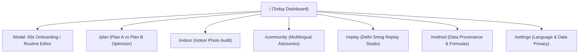
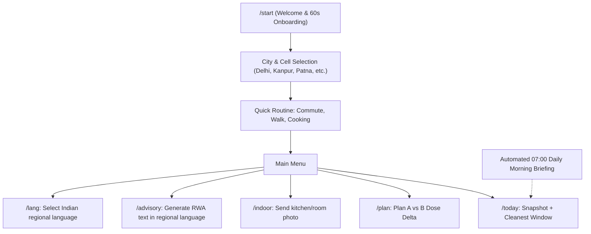

# AirDelta — Navigation Plan & UI States

**Project:** AirDelta  
**Hackathon Event:** PromptWars  
**Channels:** Web PWA (Option A) & Telegram Bot (Option B)  
**Version:** 1.0.0 · **Date:** 23 Nov 2026 · **Status:** Approved for Implementation

---

## 1. Option A: Web PWA Information Architecture

### 1.1 Web Routes Specification

| Path | Purpose | Key UI Components | Provenance Badges Displayed |
|---|---|---|---|
| `/` | **Today Overview** | - Hero AQI card with CPCB color band - Key pollutant gauges ($PM_{2.5}, PM_{10}, NO_2, O_3$) - 96-hour hourly forecast timeline - Cleanest window banner (e.g. "Cleanest between 13:00 - 15:30") - Active GRAP Stage badge | `[Measured]` or `[Forecast]` with source attribution |
| `/plan` | **Plan A vs Plan B** | - Daily routine timeline editor - Plan A vs Plan B comparison card - Inhaled PM2.5 dose savings ($\mu g$ with low/high range) - Transport emissions delta ($gCO_2e$) - Step-by-step optimization recommendations - "Assumptions Used" accordion | `[Modelled]` on doses, `[Assumed]` on emissions and breathing rates |
| `/indoor` | **Indoor Photo Audit** | - Photo upload dropzone (client-side EXIF removal) - Detected candidate sources checklist with user confirmation checkboxes - Ranked mitigation actions filtered by budget (`Free`, `Low`, `Medium`) - Mass-balance indoor concentration forecast | `[Modelled]` on indoor concentration, `[Assumed]` on CADR |
| `/community` | **Community Advisories** | - Target audience selector (`RWA Residents`, `School`, `Workplace`) - Language selector (All major Indian regional languages) - Generated advisory card with copy / forward button - $k$-anonymous community impact tally ($k \ge 5$) | `[Measured]` / `[Forecast]` on underlying AQI data |
| `/replay` | **Replay Studio** | - Scenario picker: Delhi Smog Episode (Nov 6–8, 2026, AQI 380+) - Timeline scrubber for hourly replay - Visual banner clearly stating "DEMONSTRATION REPLAY MODE" | `[Replay (Measured)]` |
| `/method` | **Methodology & Data** | - Full Constants Registry `2026-11-a` viewer - Inhaled dose and mass-balance equations - Third-party data licenses & attributions | Informational |
| `/settings` | **Settings & Privacy** | - Preferred UI language switcher (12+ Indian languages) - Delete my data (immediate purge) - Plain language privacy guarantee | Informational |

---

## 2. Option B: Telegram Bot Command Hierarchy

The Telegram Bot provides a zero-install conversational interface using inline keyboard buttons.

### 2.1 Bot Command Responses
- `/today`: Returns formatted card with current AQI, CPCB category, and `[Measured]` or `[Forecast]` tag, along with the cleanest window for outdoor tasks.
- `/plan`: Computes Plan A vs Plan B and replies with a summary card showing:
  - *Normal Day Dose:* $185\text{ }\mu g$ `[Modelled]`
  - *Optimized Plan B Dose:* $112\text{ }\mu g$ `[Modelled]` ($-39\%$ reduction)
  - *Recommended Shifts:* e.g. "Shift walk to 14:00 (+22 $\mu g$ saved); wear N95 on bike (+41 $\mu g$ saved)".
- `/indoor`: Prompts user to send a photo of kitchen or living area $\rightarrow$ returns detected sources and immediate low-cost actions.
- `/advisory`: Prompts for audience and generates an advisory in the chosen Indian language ready to be forwarded to society WhatsApp/Telegram groups.
- `/lang`: Displays inline buttons for Hindi, Bengali, Telugu, Marathi, Tamil, Urdu, Gujarati, Kannada, Odia, Malayalam, Punjabi, Assamese, and English.
