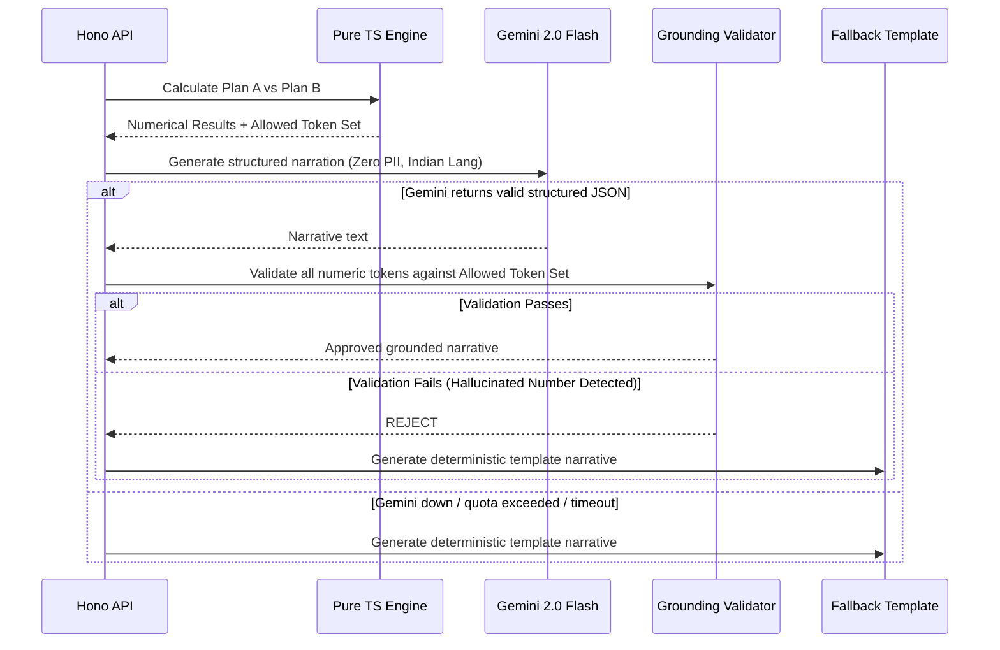

# AirDelta — Technical Requirements Document (TRD)

**Project:** AirDelta  
**Hackathon Event:** PromptWars  
**Version:** 1.0.0 · **Date:** 23 Nov 2026 · **Status:** Approved for Implementation

---

## 1. System Architecture Overview

AirDelta follows a modular, monorepo architecture with clean separation between client presentation, API orchestration, deterministic exposure modeling, and generative explanation.

```
airdelta/
├── apps/
│   ├── web/               # Astro + Tailwind CSS v4 PWA + Preact/React islands
│   └── api/               # Hono REST API + Telegram webhook handler + background workers
├── packages/
│   ├── schemas/           # Shared Zod schemas, TypeScript types, validation contracts
│   ├── engine/            # Pure TypeScript dose & mass-balance engine (zero I/O)
│   ├── air-adapters/      # Google AQ, OpenAQ v3, Open-Meteo, and Replay adapters
│   ├── i18n/              # Indian regional languages dictionary & localization engine
│   └── fix-library/       # Curated indoor mitigation solutions database
├── fixtures/              # Recorded air quality and smog episode datasets
├── evals/                 # Evals for numeric grounding, schema compliance, prompt injection
├── supabase/              # Postgres migrations, seed data, RLS test suite
└── docs/                  # PRD, TRD, Impact-Methodology, Navigation-plan
```

---

## 2. Technology Stack & Decision Matrix

| Layer | Selection | Justification |
|---|---|---|
| **Monorepo / Package Manager** | `pnpm` workspaces | Fast, deterministic linking, strict dependency isolation across packages and apps. |
| **Frontend Framework** | **Astro** + Preact/React Islands | Minimal client JS shipped to low-end mobile devices; HTML-first with islands for interactive widgets. |
| **Styling** | **Tailwind CSS v4** (`@tailwindcss/vite`) | Fast build, modern CSS engine, streamlined mobile-first responsive tokens. |
| **Backend API** | **Hono** on Node.js (v24 LTS) | Ultra-lightweight, high throughput, native TypeScript support, unified middleware pipeline for REST and webhooks. |
| **Database & Auth** | **Supabase** (Postgres 16 + RLS) | Relational integrity, built-in anonymous authentication, row-level security for tenant isolation. |
| **AI / Multimodal** | **Google Gemini API** (`@google/genai`) | High performance on structured JSON output, vision capabilities for indoor audit, native multilingual fluency. |
| **Bot Channel** | **Telegram Bot API** via `grammY` | Zero-cost outbound notifications, rich inline keyboards, free proactive 07:00 morning briefs. |
| **Testing** | **Vitest** + **fast-check** + **Playwright** | Fast unit and contract testing, mathematical property verification, and end-to-end browser workflows. |

---

## 3. Data Ingestion & Air Adapter Architecture

### 3.1 Multi-Provider Hierarchy & Fallback Chain
AirDelta abstracts data acquisition behind a unified `AirDataService` interface:
1. **Cache Layer:** In-memory LRU + DB cache keyed on spatial grid cells (`0.01°` lat/lng $\approx 1.1\text{ km}$). TTL = 60 minutes for current readings, 6 hours for forecasts.
2. **Provider 1 (Primary - Precision):** Google Air Quality API requesting the Indian National AQI standard (`ind_cpcb`) and 96-hour hourly forecasts.
3. **Provider 2 (Secondary - Ground Truth):** OpenAQ v3 fetching physical CPCB/DPCC monitoring stations within 25 km ($< 3\text{h}$ freshness) $\rightarrow$ labelled with `Measured` badge.
4. **Provider 3 (Tertiary - Fallback):** Open-Meteo European CAMS air quality model $\rightarrow$ labelled with `Modelled` badge.
5. **Provider 4 (Replay / Offline):** Deterministic JSON fixtures loader from `fixtures/` for local development, CI pipelines, and demonstration scenarios.

### 3.2 Canonical `AirSnapshot` Schema
```ts
interface AirSnapshot {
  cell: string;                       // e.g. "28.61:77.21"
  ts: string;                         // ISO 8601 UTC string
  pm25: number | null;                // ug/m3
  pm10: number | null;                // ug/m3
  indexValue: number | null;          // e.g. 385
  indexStandard: "ind_cpcb" | "us_epa" | "eu_aqi" | "none";
  category: string | null;            // "Severe", "Very Poor", etc.
  source: "google_aq" | "openaq" | "open_meteo" | "replay";
  badge: "measured" | "forecast" | "modelled" | "assumed";
  fetchedAt: string;
  ttlSec: number;
  license: string;
  attribution: string;
  stationDistanceKm?: number;
}
```

---

## 4. Exposure & Impact Engine Specification (`@airdelta/engine`)

The engine contains zero network, file, or database I/O. It accepts structured input and outputs deterministic numerical ledgers:

### 4.1 Inhaled PM2.5 Dose Formula
$$D = \sum_{seg} C_{seg} \times VE_{seg} \times \Delta t_{seg}$$
Where:
- $C_{seg} = C_{out}(t) \times F_{micro}(seg) \times (1 - \eta_{mask})$
- $F_{micro}(seg)$ is the microenvironment penetration factor (e.g. sealed auto vs open 2-wheeler vs metro).
- $VE_{seg}$ is the age- and activity-specific minute ventilation rate ($m^3/h$).
- $\Delta t_{seg}$ is segment duration in hours.

### 4.2 Single-Compartment Mass-Balance Indoor Model
$$\frac{dC_{in}}{dt} = P \lambda C_{out} - \left(\lambda + k + \frac{\text{CADR}}{V}\right) C_{in} + \frac{S}{V}$$
Where $P$ is penetration efficiency, $\lambda$ is air exchange rate ($h^{-1}$), $k$ is surface deposition rate ($h^{-1}$), $\text{CADR}$ is Clean Air Delivery Rate ($m^3/h$), $V$ is room volume ($m^3$), and $S$ is indoor source emission rate ($\mu g/h$).

### 4.3 Emissions Ledger
Avoided emissions calculated from modal emission factors ($gCO_2e/km$) based on documented Indian urban transport baselines.

---

## 5. Gemini AI Integration & Grounding Verification



### 5.1 Zero-PII Prompt Policy
Prompts never include personal names, email addresses, exact home addresses, or private medical records. Inputs are restricted to:
- Coarse spatial cell ID (`28.61:77.21`).
- Family member age bands (`child`, `adult`, `senior`).
- Generic caution flag (`true`/`false`).
- Routine activity tags (`commute_bus`, `cooking_gas`, `outdoor_walk`).

---

## 6. Supabase Database Schema & Security (RLS)

All database tables are protected with PostgreSQL Row Level Security (RLS). Anonymous users authenticate via Supabase Anonymous Auth and may only view or update rows matching their own `owner = auth.uid()`.

### 6.1 Community Privacy: $k$-Anonymity
Community impact views are exposed strictly through a PostgreSQL `SECURITY DEFINER` view that enforces:
```sql
CREATE VIEW community_group_impact WITH (security_invoker = false) AS
SELECT 
  group_id,
  CASE WHEN count(distinct household_id) >= 5 THEN count(distinct household_id) ELSE NULL END as active_households,
  CASE WHEN count(distinct household_id) >= 5 THEN sum(actions_count) ELSE NULL END as total_actions_taken
FROM group_members
GROUP BY group_id;
```
If a group has fewer than 5 member households, aggregate metrics evaluate to `NULL`.

---

## 7. Non-Functional Requirements & Resilience
- **API Latency:** $p95 \le 350\text{ ms}$ for cached `/v1/air`; $p95 \le 3.5\text{ s}$ for Plan A/B generation with Gemini narration; $p95 \le 150\text{ ms}$ for deterministic template fallback.
- **Circuit Breaker:** 3 consecutive failures to upstream APIs trips circuit into open state for 120 seconds, directly serving the next provider in the fallback hierarchy.
- **Storage Cap Defense:** Automatic pruning removes plans older than 30 days to ensure the database stays safely within the 500 MB free-tier storage limit.
