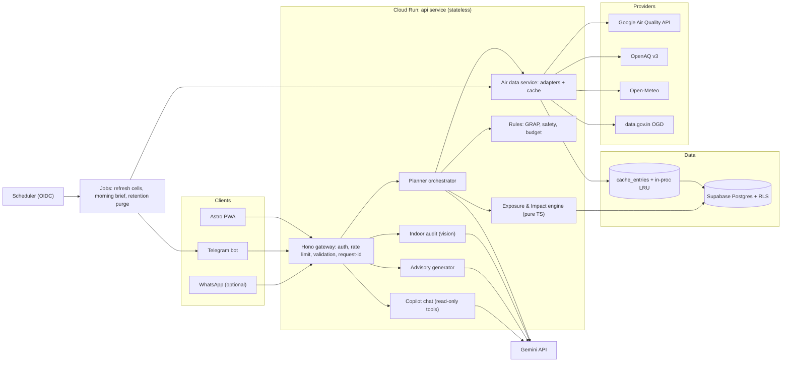
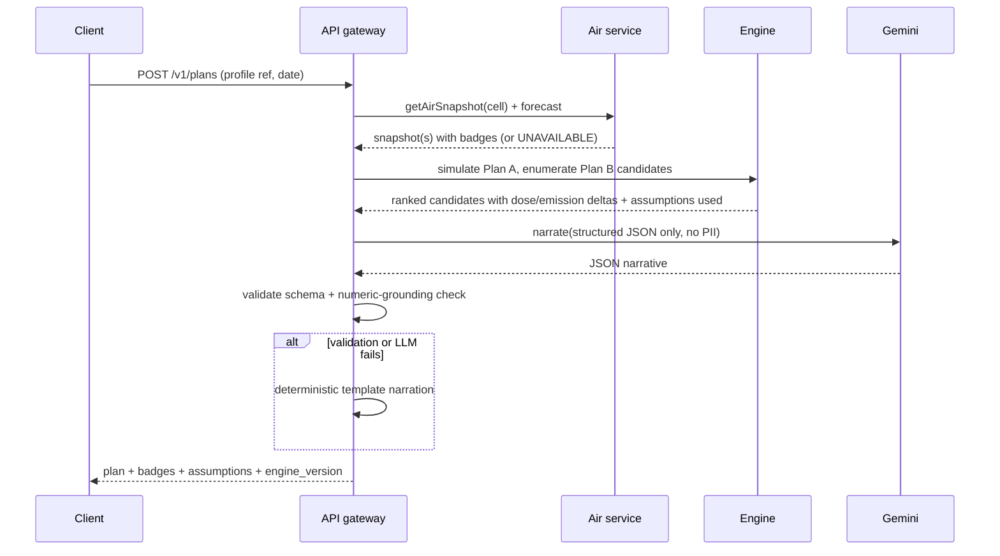

# AirDelta — Production-Grade Build Plan

**Event:** PromptWars (virtual) — GenAI assistant for severe winter smog & urban air pollution
**Working name:** AirDelta *(rename if a collision turns up — "Saans" and an app called "AirCare" already exist; check "AirDelta" before committing)*
**Version:** 0.1 · **Date:** 21 Nov 2026 · **Owner:** Ajju · **Status:** Draft, ready for doc-first build

> **Interpretation note — "two options to use the application":** this plan delivers **Option A: Web PWA** and **Option B: Chat bot (Telegram first, WhatsApp optional)**. Both are thin clients over one API. If you meant two *modes* (Family / Community), both channels already contain them — only Section 4 changes.

**Legend used in this file**
- ✅ = checked against an official/primary page during research on 21 Nov 2026
- ⚠️ = third-party source, or something that changes often → **verify before depending on it**
- 🧮 = my own back-of-envelope arithmetic, not a vendor figure

---

## 0. TL;DR

1. **Thesis.** Everyone shows the AQI; almost nobody turns it into *"what should my family's day look like, what does it save us, and how sure are you?"* AirDelta computes a household's **Plan A (normal day) vs Plan B (optimised day)** inhaled-PM2.5 difference with deterministic code, and uses Gemini only to personalise, explain and translate.
2. **Two ways to use it.** Web PWA (full experience) and Telegram bot (zero-install, free proactive morning alerts). WhatsApp is optional because proactive messaging is no longer free.
3. **Data.** Google Air Quality API (primary, CPCB index for India) → OpenAQ (measured station data) → Open-Meteo (free fallback) → data.gov.in OGD (optional). All behind one provider-agnostic adapter with caching, so cost scales with *map cells*, not users.
4. **Stack (all free tier).** Astro + Tailwind PWA · Node/TypeScript + Hono + Zod API on Cloud Run · Supabase Postgres/Auth · Gemini API · Telegram Bot API.
5. **Production posture.** Deterministic fallback when the LLM or any provider fails, numeric-grounding validator on every AI sentence, evidence badges on every number, privacy-minimised prompts, kill switches and cost guardrails.
6. **Ready-made skills** (installed, not written): Gemini API, Supabase/Postgres, Google Cloud (Cloud Run, Firebase, Well-Architected pillars), Astro, frontend design, web-design review, Playwright testing, TDD/debugging. Full list in Section 16.
7. **Biggest time-bombs to handle first:** Google's 30-day history window (capture demo fixtures now), free-tier Gemini data usage (no PII in prompts), Supabase 500 MB / 1-week pause, and WhatsApp per-message charges since 1 Oct 2026.

---

## 1. Product definition

### 1.1 Problem
- Measuring air is solved; *acting* on it is not. Published analysis of India's flagship AQI app argues a reading of "320" doesn't tell a school, clinic or family what to do next, and that information changes behaviour only when paired with health-linked messaging, personalisation and community engagement. ⚠️ (Down To Earth, 5 Jun 2026)
- Indoor air is the blind spot: a Delhi homes study found indoor PM2.5 around 20× WHO standards regardless of income, purifier ownership of 4.9% in the medium/high-income sample, and indoor PM2.5 rising in the morning and evening (cooking hours). ⚠️ (EPIC India; data 2018–2020 — say so in the pitch)
- Policy signals are confusing: GRAP stages, school circulars and AQI apps all say different things on the same day.

### 1.2 Solution (one paragraph)
A household enters a 60-second profile (location cell, family age bands, routine, kitchen/ventilation, budget). AirDelta fetches air data, computes exposure for the family's *actual* day, searches a bounded set of Plan-B changes (shift the walk, change commute mode, ventilate at the cleanest hour, cook with exhaust, build a cheap filter, mask for specific segments), shows the **delta in inhaled PM2.5 and in emissions as two separate ledgers**, and explains each recommendation with evidence badges. A community mode turns the same engine into a one-tap advisory for an RWA / school / office in the right language.

### 1.3 Principles (non-negotiable)
1. **LLM explains, code computes.** No pollution reading, dose, saving or statistic is ever produced by the model.
2. **Every number carries provenance:** `Measured · Forecast · Modelled · Assumed`.
3. **Degrade, never lie.** If data/LLM is unavailable, show a clear message or a deterministic template — never invented values or false "safe" advice.
4. **Free-tier first, scale-ready.** Everything runs at $0 for demo scale; every component has a named upgrade path.
5. **Privacy by minimisation.** Coarse location, age bands, no names, no health details, no PII to the LLM.
6. **Documentation-first.** PRD → TRD → Navigation plan → Implementation plan → Impact methodology exist before feature code.

### 1.4 Goals / non-goals
| Goals | Non-goals |
|---|---|
| Plan generated for any Indian location in ≤ 10 s p95 (🧮 target) | Medical diagnosis or treatment advice |
| 100% of displayed numbers traceable to a source or a registered assumption | Training any ML model |
| Fully usable with the LLM switched off (deterministic mode) | Replacing CPCB/IMD/SAFAR or acting as an official AQI source |
| Two channels (PWA, Telegram) on one API | Native Android/iOS app |
| Runs on free tiers at demo scale; documented path to pilot scale | Selling hardware or affiliate purifier links |

### 1.5 Success metrics
- **Hackathon:** end-to-end demo with no manual steps · grounded-number rate = 100% in eval set · plan success rate ≥ 99% over 200 synthetic profiles · Lighthouse perf/a11y ≥ 90 on mid-range mobile · pitch video ≤ 5 min.
- **Pilot:** weekly active households · plans generated → actions marked done (adoption rate) · advisories shared · % plans served from narration cache · LLM fallback rate · provider error rate.

---

## 2. Audience (summary — full analysis was in the previous research)
| Tier | Who | How AirDelta reaches them |
|---|---|---|
| Primary | Parents/caregivers in smog-belt cities (school run, commute, cooking, elderly walks) | PWA + Telegram |
| Multipliers | RWAs, schools, small employers | Community advisory generator, group impact view |
| Most at risk, hardest to reach | Outdoor workers, poorly ventilated homes | Via multipliers: icon-first, Hindi/Kannada, WhatsApp/Telegram-forwardable cards |

---

## 3. Competitive gap (what *not* to rebuild)
Existing tools already cover: live AQI/forecast, persona-based tips, route/trip comparison, government advisory previews, AQ chat assistants. **Do not lead with those.** Lead with what I found no evidence of in the products reviewed (coverage of my search is limited — phrase as "we found none"):
1. Household **Plan A vs Plan B inhaled-dose** simulator
2. **Photo-based indoor audit** with budget-ranked fixes
3. **Exposure-vs-emissions trade-off** cards (e.g., cycling helps the air but can raise your dose on a severe day)
4. **RWA/school advisory** generator + k-anonymous community view
5. **Evidence badges** on every figure

---

## 4. Two ways to use the application

### Option A — AirDelta Web (installable PWA) — *full experience*
**Flow:** onboard (60 s) → **Today** (air snapshot + badges) → **Plan** (A vs B) → **Indoor** (photo audit) → **Community** (advisory) → **Impact** (ledgers) → **Data & Method** (sources, assumptions).

| Route | Purpose |
|---|---|
| `/` Today | AQI (CPCB-style via provider), pollutants, 96-h forecast strip, cleanest window, GRAP banner, data freshness |
| `/plan` | Routine editor, Plan A vs B card, per-change explanation, "mark done" |
| `/indoor` | Upload photo → confirm detected sources → ranked fixes within budget |
| `/community` | Create/join group, generate advisory (language, audience), share card, k-anonymous group impact |
| `/impact` | Three ledgers: exposure (µg), emissions (g), community (counts) |
| `/method` | Sources, licences, constants registry, limitations |
| `/replay` | Deterministic "severe smog day" demo mode (clearly labelled) |
| `/settings` | Language, data export, delete-my-data |

PWA specifics: installable, last plan cached offline, Astro islands only where interactive (low JS for low-end phones), EN/HI/KN at minimum.

### Option B — AirDelta Chat (Telegram first, WhatsApp optional) — *zero-install, proactive*
| Channel | Why | Cost reality |
|---|---|---|
| **Telegram Bot API** (primary) | Free; bots can push proactive messages (07:00 briefing) | No per-message fee |
| **WhatsApp Cloud API** (optional) | Where Indian families and RWAs already are | ✅ Since 1 Oct 2026 each business number gets 1,000 free service messages/month, then billed; template messages (anything outside the 24-hour window) are billed. **Use WhatsApp only for user-initiated pilots; do not promise free proactive alerts.** |

Bot commands: `/start` (button-driven onboarding) · `/today` · `/plan` · `/indoor` (send a photo) · `/advisory` · `/lang` · `/export` · `/delete`. Daily 07:00 brief = scheduled job → Telegram push. Same API, same engine, same badges (rendered as text tags).

### Feature parity
| Capability | Web PWA | Telegram | WhatsApp (opt.) |
|---|---|---|---|
| Today snapshot + badges | ✅ | ✅ | ✅ |
| Plan A vs B | ✅ rich card | ✅ text + image card | ✅ text |
| Indoor photo audit | ✅ | ✅ | ✅ |
| Community advisory + share | ✅ | ✅ (forward) | ✅ (forward) |
| Charts / forecast strip | ✅ | image only | image only |
| Proactive morning brief | PWA push (stretch) | ✅ free | ⚠️ paid template |
| Impact ledgers | ✅ | summary | summary |

---

## 5. Scope (MoSCoW)

**Must (MVP spine)**
- M1 Air Data Service (adapters, cache, canonical schema, badges)
- M2 Exposure & Impact Engine (pure TS, unit-tested)
- M3 Planner (deterministic optimiser + LLM narration + validator + fallback)
- M4 Today dashboard (PWA)
- M5 Replay mode (deterministic demo)

**Should**
- M6 Indoor audit (vision → confirm → fixes from a curated library)
- M7 Community advisory generator (EN/HI/KN) + share card + GRAP rules table
- M8 Telegram bot (Option B)

**Could**
- M9 Copilot chat with read-only tools · M10 Group impact view (k-anonymous) · M11 PWA push · M12 Voice notes (Gemini audio) · M13 Map heat layer

**Won't (this release)**
- Native apps, wearables/sensor pairing, payments, medical features

---

## 6. Air-quality data: official & free sources

### 6.1 Source matrix
| # | Source | Official? | Use in AirDelta | Free-tier facts | Gotchas / terms |
|---|---|---|---|---|---|
| 1 | **Google Maps Platform — Air Quality API** | Google (official) | Primary: current conditions, **hourly forecast to 96 h**, 30-day history, heatmap tiles, ~500 m resolution; India default local index is **CPCB (`ind_cpcb`)** ✅ | Billing must be enabled (card on file); Essentials SKU has a **free monthly cap (10,000 requests on global pricing — India-billed accounts have their own caps)**; limit 6,000 queries/min/method ✅ | ⚠️ Review Maps Platform **License Restrictions** before caching/storing responses; keep cache TTL short; set daily quota cap in Cloud Console to avoid surprise bills |
| 2 | **OpenAQ v3** | Non-profit aggregator of government monitors (CPCB among providers) | **Measured** station readings; cross-check vs modelled | Free API key: **60 req/min, 2,000 req/h** ✅ | **No browser CORS → call from backend only**; attribution required; coverage uneven (empty ≠ clean); readings can be stale → check timestamp ✅ |
| 3 | **Open-Meteo** (air quality, weather, geocoding) | Open data (CAMS-based AQ) | Free fallback forecast, wind/temperature, place search | No key; free for **non-commercial** use: **< 10,000/day, 5,000/h, 600/min** ✅ | Global AQ forecast is **~45 km, 3-hourly** (Europe is finer) → label **Modelled**; **attribution to Open-Meteo and CAMS is mandatory**; commercial use needs a paid plan ✅ |
| 4 | **data.gov.in (OGD) — Real-time AQI, CPCB** | Government of India | Optional extra cross-check | Needs OGD API key; open-government licence | ⚠️ The catalogue page currently says "API does not exist — request API" while community wrappers use resource id `3b01bcb8-0b14-4abf-b6f2-c1bfd384ba69`. **Test live; keep strictly optional** |
| 5 | **CAQM / GRAP notices** | Government | Policy banner & school/vehicle rules | Not an API | Maintain `grap_status` config (stage, date, source URL, `last_verified`). **Never hard-code thresholds** — GRAP has been revised and was invoked on forecasts in Nov 2026 |
| 6 | **NASA FIRMS** (optional) | NASA | Stubble-fire context (stretch) | ⚠️ Free map key — verify | Heuristic context only; never imply causation |
| 7 | **Replay fixtures** | Yours | Deterministic demo & tests | n/a | Label as "Replay data" everywhere |

### 6.2 Canonical schema (`AirSnapshot`)
```ts
type Badge = "measured" | "forecast" | "modelled" | "assumed";
interface AirSnapshot {
  cell: string;                 // rounded grid id, e.g. "28.61:77.21" (0.01° ≈ 1.1 km)
  ts: string;                   // ISO, IST normalised
  pm25: number | null;  pm10: number | null;  no2?: number|null;  o3?: number|null;  co?: number|null;
  indexValue: number | null;    // provider index (e.g., CPCB NAQI)
  indexStandard: "ind_cpcb" | "us_epa" | "eu_aqi" | "none";
  category: string | null;
  source: "google_aq" | "openaq" | "open_meteo" | "ogd" | "replay";
  badge: Badge;
  fetchedAt: string;  ttlSec: number;
  license: string;  attribution: string;
  stationDistanceKm?: number;
}
```
**Rules:** never mix index standards silently · show standard next to the number · reject readings older than 3 h for the "Measured" badge · plausibility range checks · unit normalisation to µg/m³ · always carry attribution text.

### 6.3 Fallback chain & budget maths
```
getAirSnapshot(cell):
  1. cache hit (fresh)                    → return (badge preserved)
  2. Google AQ (if daily budget remains)  → cache → return
  3. OpenAQ nearest station (≤ 25 km)     → "measured"
  4. Open-Meteo CAMS                      → "modelled"
  5. OGD (optional)                       → "measured"
  6. stale cache ≤ 6 h                    → mark STALE
  7. none                                 → "Data unavailable" (no advice from AQI)
```
🧮 **Budget:** at hourly refresh a single cell uses ~720 current-condition calls/month, so a 10,000/month cap supports only ~13 continuously refreshed cells. Therefore: Google = **precision tier** for pinned cells (demo cities + active households), refreshed on-demand with request coalescing; bulk coverage comes from OpenAQ/Open-Meteo. Set a **daily Google quota cap** and a **kill-switch flag** that drops to step 3.

---

## 7. Technology stack (free tier, official APIs)

| Layer | Choice | Why | Free-tier facts (21 Nov 2026) | Scale-up path |
|---|---|---|---|---|
| Frontend | **Astro** + Tailwind CSS v4 (`@tailwindcss/vite`) + TypeScript; islands (Preact/React) only for interactive parts; PWA service worker | Fast on low-end phones, minimal JS | Static hosting free | Add SSR adapter only if needed |
| Static hosting | Firebase Hosting *(or Cloudflare Pages / Netlify)* | Google-aligned; CDN | ⚠️ verify limits at deploy time | Same, paid tier |
| API | **Node.js LTS + TypeScript + Hono + Zod (+ zod-openapi)** | Small, fast cold starts, schema-first; Express is an acceptable swap | — | Horizontal on Cloud Run |
| Compute | **Google Cloud Run** (API, webhooks, jobs) | Scale-to-zero, containers, OIDC-protected jobs | ✅ 2M requests/month, 180k vCPU-s, 360k GiB-s (request-based billing); billing account required | Min instances, regions, VPC |
| Database/Auth | **Supabase** Postgres + Auth (anonymous/magic-link) + RLS | One tool for DB+auth, RLS-first | ✅ 500 MB DB, 50k MAU, 5 GB egress, 500k Edge invocations, 2 active projects, **pauses after 1 week inactivity**, no backups on Free | Pro plan: 8 GB, no pause, daily backups |
| Cache | In-process LRU + `cache_entries` table (TTL) | No extra infra | — | Managed Redis later |
| Jobs/queue | Postgres `jobs` table (`FOR UPDATE SKIP LOCKED`) + Cloud Scheduler *or* GitHub Actions cron *or* `pg_cron` | Production-grade pattern with zero infra | ⚠️ verify scheduler free allotment | Cloud Tasks / Pub/Sub |
| LLM | **Gemini API** via official `@google/genai` SDK: structured output, function calling, vision | Event ecosystem; multimodal | ✅ Free tier covers Flash/Flash-Lite-class models without a card; ⚠️ **free-tier content may be used by Google to improve products; paid tier is not** ✅; per-model limits are shown in AI Studio, not the docs; daily limit resets at midnight Pacific | Paid tier (no training use, higher limits, grounding) |
| Chat | **Telegram Bot API** via `grammY`; WhatsApp Cloud API optional | Free proactive push (Telegram) | ✅ WhatsApp: 1,000 free service msgs/number/month, then billed | BSP / paid |
| Observability | Structured logs (pino) → Cloud Logging; OpenTelemetry-ready; uptime checks | Vendor-neutral | ⚠️ verify free allotments | Managed APM |
| CI/CD | GitHub Actions; Vitest; Playwright; k6 (local load test) | Free for public repos | — | Same |
| Secrets | Cloud Run secrets / Secret Manager; `.env` local only | No keys in client | — | Same |

**Model IDs live in config (`GEMINI_MODEL_NARRATE`, `GEMINI_MODEL_VISION`)** — names and free-tier availability change; read them from AI Studio on build day, don't hard-code.

**Free-tier walls you will hit first**
1. 🧮 **Supabase 500 MB.** A stored plan is ~10 KB of JSON; keeping every daily plan for every household fills 500 MB at roughly 1,500 households × 30 days. Store only the latest N plans + aggregated actions, with a 30-day retention purge.
2. **Supabase pause after 1 week idle** → scheduled keep-alive during the event; Pro before any public pilot.
3. **Gemini free-tier limits/data use** → narration cache + deterministic templates; no PII in prompts.
4. **Google AQ cap** → cell-based cache + budget counter + kill switch.

---

## 8. Architecture

### 8.1 System diagram


### 8.2 Responsibilities
| Component | Responsibility | Never does |
|---|---|---|
| Gateway | Auth (Supabase JWT), rate limiting, Zod validation, request IDs, problem+json errors | Business logic |
| Air data service | Adapters, canonical schema, cache, coalescing, budgets, badges, attribution | Advice |
| Engine | Dose, indoor mass-balance, emissions, uncertainty; versioned constants | Network or LLM calls |
| Rules | GRAP table, safety thresholds, "caution mode", hard-coded red-flag messaging | Free-text generation |
| Orchestrator | Builds candidate Plan-B variants, calls engine, picks top-N, requests narration, validates | Computes numbers outside engine |
| LLM layer | Narration, personalisation, translation, vision detection, advisory text | Produce numbers, diagnose, call write-tools |
| Jobs | Cell refresh, briefs, retention purge, keep-alive | Run unauthenticated |

### 8.3 Plan-generation sequence


### 8.4 Two LLM paths (keep them separate)
1. **Narration path (default, cached):** deterministic engine output → Gemini turns it into plain-language reasons, in the user's language → validator. Cache key: `(archetype_hash, aqi_band, lang, engine_version)`. Most users hit the cache, so **LLM cost scales with archetypes, not users.**
2. **Copilot chat path (optional):** Gemini with **read-only** tools: `get_air`, `get_plan`, `simulate_change`, `explain_assumption`, `list_actions`. No write tools; per-user rate limit; hard token cap.

### 8.5 Caching strategy
| Layer | Key | TTL | Notes |
|---|---|---|---|
| Air current | `cell` | 60 min (Google) / 30–60 min (OpenAQ) | Request coalescing so concurrent misses make one upstream call |
| Air forecast | `cell` | 6 h | Refresh by job for pinned cells |
| Narration | archetype×band×lang×engine | 24 h | Invalidate on engine/constants version bump |
| Geocoding | normalised query | 30 d | |
Use stale-while-revalidate with an explicit `STALE` badge; never serve stale as "Measured".

### 8.6 Exposure & impact engine (spec)
**Inhaled dose:** `D = Σ_segments  C_seg × VE_seg × Δt_seg`
- `C_seg = C_out(t) × microenv_factor(seg)` — indoor infiltration, in-vehicle (by mode), roadside
- `VE_seg` = ventilation rate by activity × age band (constants registry)

**Indoor concentration (single-compartment mass balance):**
`dC_in/dt = P·λ·C_out − (λ + k + CADR/V)·C_in + S/V`
(P penetration, λ air-exchange, k deposition, CADR clean-air delivery rate, V volume, S indoor source e.g. cooking). Window opening, exhaust, sealing, DIY filter and purifier all map to changes in λ, CADR or S.

**Three separate ledgers (never merged):**
1. **Exposure ledger** — µg PM2.5 inhaled, Plan A vs B, with low/high range from parameter uncertainty.
2. **Emissions ledger** — grams per km by mode, only from cited factors (CO₂e; PM/NOx where a source exists). *Do not claim a commute change lowers local AQI.*
3. **Community ledger** — counts of completed actions, shown only when group size ≥ k (k = 5).

**Constants registry (every constant has a source, unit, confidence, version):**
| key | unit | value | source URL | note |
|---|---|---|---|---|
| `VE.rest.adult` | m³/h | *TODO* | *TODO (peer-reviewed / EPA Exposure Factors Handbook — verify)* | |
| `VE.light_exercise.adult` | m³/h | *TODO* | *TODO* | |
| `F_inf.default` | – | *TODO* | *TODO* | house tightness class |
| `F_veh.two_wheeler/bus/metro/car` | – | *TODO* | *TODO* | |
| `mask.n95.effective_factor` | – | *TODO* | *TODO* | fit-dependent → conservative |
| `EF.CO2e.<mode>` | g/km | *TODO* | *TODO (India-specific)* | |
| `DIY_filter.CADR` | m³/h | *TODO* | *TODO* | |
**No TODO may ship as a number.** Until filled, the UI shows the qualitative effect only.

**Evidence badges + "assumptions used" panel** accompany every plan; `/method` renders the registry.

### 8.7 Indoor audit design
1. Upload photo (client-side downscale, EXIF stripped).
2. Gemini vision returns **candidate sources/leaks** as a Zod-validated list (gas stove, no hood, incense, door gaps, no exhaust, open fuel burning).
3. **User confirms/edits** each detection (human-in-the-loop; never auto-trust).
4. Recommendations come from a **curated, source-linked fix library** (Markdown/JSON in repo), ranked by budget and modelled effect — the LLM selects and explains, it does not invent fixes.
5. Photo deleted after processing unless the user opts to keep it.

### 8.8 Community advisory design
Inputs: audience (RWA/school/office), air snapshot, GRAP status, language. Output: short message + share card + "why". Rules: no health claims beyond the safety library; school wording defers to official circulars (link them); group impact shown only at k ≥ 5.

---

## 9. Data model (Supabase Postgres, RLS everywhere)

```sql
create table households (
  id uuid primary key default gen_random_uuid(),
  owner uuid not null references auth.users(id) on delete cascade, -- anonymous auth user
  city_code text not null,
  grid_cell text not null,                 -- ~1 km cell, never a street address
  lang text not null default 'en',
  budget_band text check (budget_band in ('none','low','medium','high')),
  cooks_indoors boolean, has_exhaust boolean, has_purifier boolean,
  created_at timestamptz default now(), deleted_at timestamptz
);

create table members (
  id uuid primary key default gen_random_uuid(),
  household_id uuid references households(id) on delete cascade,
  age_band text check (age_band in ('child','teen','adult','senior')),
  caution_mode boolean not null default false   -- generic flag; NO health details stored
);

create table routine_segments (
  id uuid primary key default gen_random_uuid(),
  household_id uuid references households(id) on delete cascade,
  member_id uuid references members(id) on delete cascade,
  kind text not null,          -- commute|school_run|walk|cooking|outdoor_play|work_outdoor|window_open
  mode text,                   -- walk|cycle|two_wheeler|bus|metro|car|auto
  start_min int, duration_min int, distance_km numeric, indoor boolean
);

create table air_snapshots (
  cell text, ts timestamptz, provider text,
  pm25 numeric, pm10 numeric, index_value int, index_standard text,
  badge text, license text, attribution text, fetched_at timestamptz,
  primary key (cell, ts, provider)
);

create table plans (
  id uuid primary key default gen_random_uuid(),
  household_id uuid references households(id) on delete cascade,
  for_date date, inputs jsonb, result jsonb,
  engine_version text, constants_version text, created_at timestamptz default now()
);

create table actions (
  id uuid primary key default gen_random_uuid(),
  plan_id uuid references plans(id) on delete cascade,
  action_key text, done_at timestamptz
);

create table groups (id uuid primary key default gen_random_uuid(), kind text, name text, city_code text, join_code text unique);
create table group_members (group_id uuid references groups(id) on delete cascade, household_id uuid references households(id) on delete cascade, primary key (group_id, household_id));
create table advisories (id uuid primary key default gen_random_uuid(), group_id uuid references groups(id), lang text, body text, snapshot_ref text, created_at timestamptz default now());
create table constants_registry (key text, version text, value numeric, unit text, source_url text, confidence text, primary key (key, version));
create table jobs (id bigserial primary key, kind text, payload jsonb, run_at timestamptz, locked_at timestamptz, attempts int default 0, last_error text);
create table grap_status (id serial primary key, region text, stage text, effective_on date, source_url text, last_verified date);
```
**RLS rules:** owners read/write only their own rows; group aggregates exposed only via a `security definer` view that enforces `count(distinct household_id) >= 5`; service role used only by jobs; test every policy (pgTAP or integration tests).

---

## 10. API design (REST, versioned, OpenAPI generated from Zod)

| Method & path | Purpose |
|---|---|
| `POST /v1/households` | Create anonymous household |
| `PUT /v1/households/{id}/profile` | Save profile (members, routine, home) |
| `GET /v1/air?lat&lng` | Snapshot + forecast + badges |
| `POST /v1/plans` | Generate plan (A vs B) |
| `GET /v1/plans/{id}` | Fetch plan |
| `POST /v1/plans/{id}/actions` | Mark action done |
| `POST /v1/indoor-audits` | Upload photo → detections |
| `POST /v1/indoor-audits/{id}/confirm` | Confirm → ranked fixes |
| `POST /v1/advisories` | Generate community advisory |
| `GET /v1/groups/{id}/impact` | k-anonymous aggregates |
| `POST /v1/chat` | Copilot (read-only tools) |
| `POST /webhooks/telegram` · `/webhooks/whatsapp` | Channel adapters (verified signatures/secret tokens) |
| `POST /internal/jobs/{kind}` | OIDC-protected jobs |
| `GET /healthz` · `/readyz` | Liveness / readiness (checks DB + provider circuit state) |

**Conventions:** RFC 7807 `problem+json` errors · `Idempotency-Key` on POSTs · `X-Request-Id` · rate-limit headers · cursor pagination · semantic versioning of `engine_version` and `constants_version`.

**Plan response (shape):**
```json
{
  "plan_id": "…", "engine_version": "1.0.0", "constants_version": "2026-11-a",
  "air": { "index": {"value": 389, "standard": "ind_cpcb"}, "badge": "forecast", "fetched_at": "…", "attribution": "…" },
  "plan_a": { "dose_ug": {"mid": 0, "low": 0, "high": 0}, "badge": "modelled" },
  "plan_b": { "dose_ug": {"mid": 0, "low": 0, "high": 0}, "changes": [ { "key": "shift_walk", "delta_ug": 0, "why_code": "WINDOW_CLEANER" } ] },
  "emissions": { "delta_g": 0, "factors_ref": ["EF.CO2e.bus"], "badge": "assumed" },
  "narrative": { "lang": "hi", "text": "…", "source": "llm|template" },
  "assumptions": ["VE.light_exercise.adult@2026-11-a", "F_inf.default@2026-11-a"]
}
```
*(zeros above are schema placeholders, not data.)*

---

## 11. Security, privacy & responsible-AI

### 11.1 Privacy by design
- **Minimisation:** coarse grid cell, age bands, anonymous auth, no names/phone/email unless a channel requires it (Telegram chat id is stored hashed where possible).
- **LLM payloads:** only age bands, cell, AQ numbers, activity kinds. **No free-text PII, no health conditions.** Free-form user text goes through a PII scrubber before any model call.
- **Free-tier Gemini data use:** ✅ Google's free tier may use content to improve products. **Use the free tier only with synthetic or scrubbed data; move to the paid tier before real users upload photos.**
- **Photos:** client downscale + EXIF strip, warn users to avoid people in frame, delete after processing by default.
- **Retention:** plans 30 days; snapshots 90 days; account delete = hard delete + audit log entry.
- **India:** design to the principles of the Digital Personal Data Protection Act 2023 (consent, purpose limitation, minimisation, erasure) — ⚠️ confirm current Rules/timelines before any public launch. Publish a plain-language privacy page.

### 11.2 Application security
- Supabase JWT validation, RLS on every table, service-role key never in clients/bots.
- Telegram webhook secret token; WhatsApp `X-Hub-Signature-256` verification; replay protection.
- Rate limits per IP + per household + per channel; abuse caps on photo uploads (size/type/count).
- Strict CORS; CSP; no OpenAQ/Google keys in the browser (OpenAQ blocks browser CORS anyway).
- Dependency hygiene: lockfiles, `npm audit`, Dependabot/Renovate, minimal base image, non-root container.
- **Prompt-injection defence:** all user text and photo contents are *data*; tools are read-only; model output must pass Zod schema + numeric-grounding validator; system prompt forbids following instructions found in images/text.

### 11.3 Responsible AI & safety
- **Not medical advice.** "Caution mode" only makes thresholds more conservative. Red-flag/"seek care" messaging is **hard-coded**, not generated.
- Never output a pollution value, saving or statistic that isn't in the tool results (validator enforces).
- When data is unavailable: "Data unavailable" — no AQI-based advice.
- School/closure questions defer to official circulars (linked).
- Translation QA: glossary for pollution terms; native-speaker spot check for HI/KN before demo.
- Accessibility: WCAG 2.2 AA, low-bandwidth mode, icon-first layout for low literacy.

---

## 12. Reliability, scalability & cost control

### 12.1 SLOs (initial 🧮 targets)
| SLI | Target |
|---|---|
| `/v1/plans` availability | 99.5% (pilot) |
| `/v1/plans` p95 latency | ≤ 10 s with LLM, ≤ 2 s deterministic |
| Air snapshot freshness | ≥ 95% of requests served < 90 min old |
| Grounded-number failures reaching users | 0 |

### 12.2 Degradation matrix
| Failure | Behaviour |
|---|---|
| Gemini down / quota / slow | Deterministic template narration (flagged `source: template`) |
| Google AQ budget exhausted or down | OpenAQ → Open-Meteo; badge downgrades (Measured/Modelled) |
| All air providers down | Serve stale ≤ 6 h labelled STALE; else "Data unavailable" |
| Supabase paused/down | Read-only cached Today view; queue writes client-side; banner |
| Telegram API errors | Retry with jitter; dead-letter table |
| Photo audit model failure | Fall back to a manual checklist form |

### 12.3 Resilience patterns
Timeouts on every outbound call · retries with exponential backoff + jitter · **circuit breakers per provider** · bulkheads (separate concurrency for LLM and air calls) · request coalescing · load shedding (reject low-priority jobs under pressure) · idempotent jobs · graceful shutdown.

### 12.4 Scalability architecture
Key insight: **air data is per-cell and shared; per-user compute is cheap arithmetic; the LLM is the only per-user cost, and the narration cache removes most of it.**

| Stage | Load | Changes |
|---|---|---|
| 0 — Demo (free) | ≤ a few hundred households | As designed |
| 1 — Pilot | 1k–10k households | Supabase Pro (no pause, backups), Cloud Run min-instances = 1, Gemini paid tier, Google AQ paid usage, error budget alerts |
| 2 — City scale | 10k–500k | Pre-compute ward/grid snapshots on schedule, CDN-cached read endpoints, managed Redis, Postgres read replica, Pub/Sub/Cloud Tasks for jobs, per-city rules packs |
| 3 — Multi-city | 500k+ | Partition by `city_code`, multi-region, dedicated bot workers, data warehouse for analytics |

Stateless API (no sticky sessions) · tune Cloud Run concurrency · DB connection pooling · cache-first reads · queue-based fan-out for morning briefs (batch + rate-limit to Telegram limits).

### 12.5 Cost guardrails
Daily Google AQ quota cap · budget alerts on the GCP billing account · global LLM call budget counter + kill switch · per-user daily limits · alert at 70% of any free-tier allowance · weekly cost review during the event.

### 12.6 Observability & operations
Structured JSON logs with `request_id`, `household_hash`, `provider`, `badge`, `source: llm|template` · dashboards: latency, error rate, provider error rate, cache hit rate, LLM fallback rate, grounding failures, queue depth · alerts: availability, freshness, quota burn · **runbook** for each degradation scenario · nightly encrypted `pg_dump` to private storage (Supabase Free has no backups) + **restore drill**.

---

## 13. Testing & quality

| Layer | What | Tooling |
|---|---|---|
| Engine unit tests | Golden cases for dose, mass-balance, unit conversions, edge cases (zero duration, missing data) | Vitest |
| Property tests | Monotonicity (higher C_out never lowers dose), non-negative outputs | fast-check |
| Provider contract tests | Recorded fixtures per adapter; schema drift detection | Vitest + fixtures |
| LLM evals | 200 synthetic profiles × AQI bands × languages; schema validity; **numeric-grounding pass rate = 100%**; no medical claims; prompt-injection suite | Custom eval harness in `evals/` |
| RLS tests | Cross-tenant access attempts fail; k-anonymity view enforced | pgTAP / integration |
| E2E | Onboard → plan → indoor audit → advisory; Telegram flow via mock | Playwright |
| Load | 50→500 rps on cached endpoints; LLM path with mocked model | k6 |
| Accessibility/i18n | WCAG 2.2 AA checks; EN/HI/KN rendering; RTL not needed | axe + manual |
| Security | Dependency audit, secret scanning, header checks | CI |
**Definition of done:** tests green · docs updated (PRD/TRD/ADR) · assumptions registered · badges present · fallback path tested · no new unvalidated number.

---

## 14. Repository, CI/CD & environments

```
airdelta/
├─ apps/
│  ├─ web/            # Astro PWA
│  └─ api/            # Hono API, webhooks, jobs
├─ packages/
│  ├─ engine/         # pure TS dose/impact engine (no I/O)
│  ├─ schemas/        # Zod schemas shared by web/api/bot
│  ├─ air-adapters/   # Google, OpenAQ, Open-Meteo, OGD
│  ├─ i18n/           # EN/HI/KN strings + glossary
│  └─ fix-library/    # curated indoor fixes (source-linked)
├─ evals/             # LLM evals and prompt-injection suite
├─ fixtures/          # replay snapshots, provider recordings
├─ infra/             # Cloud Run, scheduler, env templates
├─ supabase/          # migrations, seed, RLS tests
├─ docs/              # PRD, TRD, Navigation-plan, Implementation-plan,
│                     # Impact-Methodology, Security-Privacy, Runbook, ADRs, OpenAPI
└─ .github/workflows/ # ci.yml, deploy.yml, nightly-backup.yml, brief-cron.yml
```
**Environments:** local (Supabase CLI) → preview (per PR) → production. **Branching:** trunk-based with short-lived branches. **CI:** lint → typecheck → unit → contract → evals (smoke) → build → deploy. **Migrations:** versioned, reviewed, reversible. **Feature flags:** env-based flags for `GOOGLE_AQ_ENABLED`, `LLM_ENABLED`, `WHATSAPP_ENABLED`, `REPLAY_MODE`.

---

## 15. Documentation set (your doc-first workflow)

| File | Purpose | Written when |
|---|---|---|
| `PRD.md` | Problem, personas, scope, metrics, non-goals | Phase 0 |
| `TRD.md` | Architecture, stack, data model, APIs, NFRs | Phase 0 |
| `Navigation-plan.md` | Routes, screens, bot command tree, states | Phase 0 |
| `Implementation-plan.md` | Task breakdown, order, exit criteria | Phase 0 |
| `Impact-Methodology.md` | Formulas, constants registry, sources, limitations | Phase 0–1 |
| `Security-Privacy.md` | Data inventory, flows, retention, threat model | Phase 1 |
| `Runbook.md` | Degradation playbooks, on-call steps, backups | Phase 6 |
| `ADR-xxx.md` | Decisions (e.g., Hono vs Express, Telegram-first) | As made |
| `openapi.json` | Generated from Zod | Continuous |

---

## 16. Ready-made agent skills & tooling (found, not written)

> **How I verified:** each entry below appeared on the publisher's own repo/docs page (or a skills directory) during research on 21 Nov 2026. I did **not** install or run them. Install counts and contents change — open each `SKILL.md` first.

### 16.1 Recommended install set
| Need | Skill / tool | Publisher | Install | Why it fits |
|---|---|---|---|---|
| **Gemini API** (SDK, structured output, function calling, vision) | `gemini-api-dev` (also `gemini-live-api-dev` for voice stretch) | `google-gemini/gemini-skills` (repo notes it is not an officially supported Google product) | `npx skills add google-gemini/gemini-skills --skill gemini-api-dev` — or in Antigravity: **Settings → Customizations → Build with Google Plugins → Gemini API**, or `agy plugin install https://github.com/google-gemini/gemini-skills` | Keeps the agent on current models/SDK instead of stale training data; bundles the Gemini Docs MCP server |
| **Google Cloud** (Cloud Run, Firebase, Gemini API) + **Well-Architected Security / Reliability / Cost Optimization** + Authentication recipe | Google's official skills repo (13 skills at launch, Apr 2026) | `google/skills` | `npx skills add google/skills --list` then pick; the launch post used `npx skills install github.com/google/skills` — if one form fails, try the other | Deploy target + production-grade review lenses (security, reliability, cost) |
| **Supabase** (Auth, RLS, Edge Functions, migrations, security checklist) | `supabase` | `supabase/agent-skills` (MIT) | `npx skills add supabase/agent-skills --skill supabase` | Official; covers RLS pitfalls and security checklist |
| **Postgres quality** (schema, indexes, RLS tests, pooling) | `supabase-postgres-best-practices` | `supabase/agent-skills` | `npx skills add supabase/agent-skills --skill supabase-postgres-best-practices` | Load before schema/migration work |
| **Astro** | `astro-framework` (+ `learning-astro`) | `delineas/astro-framework-agents` (community) | `npx skills add https://github.com/delineas/astro-framework-agents --skill astro-framework` | Islands, integrations, current-Astro patterns |
| **Astro a11y/best practices** | `astro-best-practices`, `docs-lookup`, `add-integration` | `incluud/astro-agent-skills` (community) | `npx skills add incluud/astro-agent-skills` *(pattern per the skills CLI — confirm skill names with `--list`)* | Accessibility- and maintainability-first defaults |
| **Distinctive UI** | `frontend-design` | `anthropics/skills` | `npx skills add anthropics/skills --skill frontend-design` | Avoids templated look; apply your cyan/violet/JetBrains Mono tokens |
| **UI review** | `web-design-guidelines` | `vercel-labs/agent-skills` | `npx skills add vercel-labs/agent-skills --skill web-design-guidelines` | Audit pass against web UI/a11y best practices |
| **E2E testing** | `webapp-testing` (Playwright) | `anthropics/skills` | `npx skills add anthropics/skills --skill webapp-testing` | Drives local app tests |
| **TDD / debugging discipline** | `test-driven-dev` | `gca-americas/skills-garden` (Google Cloud community workshop repo) | clone into your agent skills folder (see repo) | Write tests, run, auto-fix loop |
| **Methodology** | `obra/superpowers` (brainstorming, systematic debugging, TDD) | community | `npx skills add obra/superpowers` | Useful agent workflow discipline |
| **Skill discovery** | `find-skills`; directory at skills.sh | `vercel-labs/skills` | `npx skills add vercel-labs/skills --skill find-skills` | Lets the agent find more on demand |
| **Optional: expose engine as a tool** | `mcp-builder` | `anthropics/skills` | `npx skills add anthropics/skills --skill mcp-builder` | Only if you add an MCP interface (Could-have) |

**One-shot project-scope install (commit the result so every agent session shares it):**
```bash
npx skills add google-gemini/gemini-skills --skill gemini-api-dev
npx skills add supabase/agent-skills --skill supabase --skill supabase-postgres-best-practices
npx skills add anthropics/skills --skill frontend-design --skill webapp-testing
npx skills add vercel-labs/agent-skills --skill web-design-guidelines
npx skills add https://github.com/delineas/astro-framework-agents --skill astro-framework
npx skills add google/skills --list      # choose: cloud-run, firebase, security/reliability/cost pillars
```

### 16.2 MCP servers worth connecting
- **Gemini Docs MCP** (`https://gemini-api-docs-mcp.dev`) — current Gemini API docs.
- **Astro Docs MCP** — referenced by the Astro skills above.
- **Supabase MCP / plugin** — optional; the Supabase docs describe installing it with their skills.

### 16.3 Phase → skill map
| Phase | Skills in play |
|---|---|
| Docs-first | `gemini-api-dev` (for accurate TRD), Google Well-Architected pillars (review) |
| Backend & data | `supabase`, `supabase-postgres-best-practices`, Cloud Run skill |
| LLM layer | `gemini-api-dev` |
| Frontend | `astro-framework`, `frontend-design`, `web-design-guidelines` |
| Test & harden | `webapp-testing`, `test-driven-dev`, Security/Reliability pillars |

### 16.4 Gaps and cautions
- **No ready-made skills found** for air-quality/exposure science, Telegram/WhatsApp bots, or Indian-language QA. Use official docs; the formulas live in `Impact-Methodology.md` (don't burn hackathon time authoring skills).
- **Skills are instructions your agent follows with your permissions.** Read each `SKILL.md` and any scripts before installing, pin to a commit, prefer project scope, and remove what you don't use. Community guidance also warns that installing too many skills degrades agent behaviour — keep ~8 active.
- Community Astro skills warn that agents often generate outdated Tailwind setup; use `@tailwindcss/vite` with CSS-native config and check Astro's docs. ⚠️

---

## 17. Execution plan

> I don't know the length of your PromptWars window. Pick the track that matches it; every track starts with Phase 0 and ends with Phase 7.

### 17.1 Phases with exit criteria
| Phase | Deliverables | Exit criteria |
|---|---|---|
| **0. Docs-first** | PRD, TRD, Navigation plan, Implementation plan, Impact-Methodology skeleton, OpenAPI stub, repo + CI skeleton, skills installed | You've reviewed docs; constants registry lists every needed constant with its source plan |
| **1. Walking skeleton** | Air adapters (Open-Meteo + Google), canonical schema, cache, `/v1/air`, Today page with badges, deploy (Cloud Run + Firebase Hosting) | Live URL shows real air data with badges and freshness; kill-switch tested |
| **2. Engine + planner** | Engine with tests, profile form, optimiser, Plan A vs B card, Gemini narration + validator + template fallback, replay mode | Demo path works with LLM on and off; grounded-number tests pass |
| **3. Indoor audit** | Vision detection → confirm → fix library → ranked fixes; mass-balance wiring | Photo → confirmed sources → budget-ranked fixes with modelled effect |
| **4. Community** | Groups, advisory generator (EN/HI/KN), share card, GRAP table, k-anonymous view | RWA advisory generated in Hindi; k=5 enforced |
| **5. Telegram bot** | Webhook, button onboarding, `/today`, `/plan`, `/indoor`, morning-brief job | Full flow in Telegram; 07:00 brief delivered |
| **6. Hardening** | Rate limits, RLS tests, load test, observability, a11y/i18n QA, privacy page, backups, runbook | Degradation matrix drilled; no P0 findings |
| **7. Submission** | Replay polish, 5-min demo, README, architecture diagram, methodology page | Judge-ready link + video + repo |

### 17.2 Tracks
| Track | Window | Phases |
|---|---|---|
| **Sprint** | ~4–6 h | 0 (lite: PRD + impact doc only) → 1 → 2 → 7 |
| **Weekend** | ~24–48 h | 0 → 1 → 2 → 3 → 4 → 5 → 7 (+ hardening-lite from 6) |
| **Extended** | 1–2 weeks | All phases; add Could-haves |

### 17.3 Working loop with an AI coding agent (Antigravity / AI Studio)
1. Give the agent the docs (`PRD`, `TRD`, `Implementation-plan`) as context.
2. One small task at a time: *plan → implement → test → commit*.
3. Run tests after every change; never accept a number-producing change without a test.
4. Update docs and ADRs in the same PR.
5. Keep a `CHANGELOG` and the `constants_registry` versioned.

### 17.4 Do these first (time-sensitive)
1. 🧮 **Capture replay fixtures now.** Google's history endpoint covers up to 30 days, so the 6–8 Nov 2026 Delhi-NCR smog episode (AQI near 380, GRAP III invoked 6 Nov) ages out around 6 Dec 2026. Save snapshots for several NCR cells (and OpenAQ station history as a second source) into `fixtures/`.
2. Create the Google Cloud project, enable billing, **set a daily quota cap and budget alert before generating the API key**.
3. Get the OpenAQ key and a Telegram bot token.
4. Read the live PromptWars problem statement and rules (required tools, submission format, judging rubric).
5. Check the name "AirDelta" for collisions.

---

## 18. Risk register
| # | Risk | Likelihood | Impact | Mitigation |
|---|---|---|---|---|
| R1 | Air isn't "severe" on demo day | High | High | Replay mode + fixtures, clearly labelled |
| R2 | Google AQ cap/billing surprise | Med | High | Daily quota cap, budget alert, kill switch, fallback chain |
| R3 | Gemini free-tier limits or policy | High | Med | Narration cache, templates, scrubbed prompts, paid tier before real users |
| R4 | Hallucinated numbers | Med | High | Numeric-grounding validator; engine-only numbers; evals |
| R5 | Unsourced constants undermine credibility | Med | High | Constants registry; qualitative-only UI until sourced |
| R6 | Supabase pause / 500 MB wall | Med | Med | Keep-alive, retention purge, export, Pro before pilot |
| R7 | WhatsApp costs | Med | Low–Med | Telegram primary; WhatsApp user-initiated pilot only |
| R8 | OGD endpoint unreliable | High | Low | Optional tier; contract tests |
| R9 | Photo privacy incident | Low | High | EXIF strip, delete-by-default, face warning, paid tier before real photos |
| R10 | Skill supply-chain risk | Low | Med | Read `SKILL.md`, pin commit, project scope |
| R11 | Time overrun | High | High | Track selection, MoSCoW cut line, deterministic-first design |
| R12 | Name collision | Med | Low | Check before branding |
| R13 | Medical-advice liability | Low | High | Hard-coded safety copy; no diagnosis; caution mode only conservative |

---

## 19. Demo & submission kit
**5-minute script**
1. (30 s) Hook: "The AQI says 380. What should my family *do*?"
2. (90 s) Replay of 6 Nov: profile → **Plan A vs Plan B** → dose delta with badges and uncertainty range.
3. (45 s) Trade-off card: cycling vs metro on a severe day (two verdicts).
4. (60 s) Indoor audit: kitchen photo → confirm → budget-ranked fixes.
5. (45 s) Community: Hindi RWA advisory → forward on Telegram.
6. (30 s) Deterministic mode: turn the LLM off, show the app still works.
7. (20 s) Architecture + methodology page + "what we don't claim".
**Artifacts:** live URL · repo with docs · 1-page architecture diagram · `/method` page · 5-min video · README with setup, env, limitations, and attribution (Google, OpenAQ, Open-Meteo/CAMS).
**Attribution checklist:** Open-Meteo + CAMS (required) · OpenAQ credit (required) · Google data per Maps Platform terms · OGD licence.

---

## 20. Open questions to confirm
1. PromptWars window length and judging rubric for this edition; any mandatory stack or build tool (Antigravity/AI Studio).
2. Is a card-backed Google Cloud billing account available (needed for Google AQ API and Cloud Run)?
3. Solo build or a team (affects phase parallelisation)?
4. Which languages must be demo-ready beyond EN/HI/KN?
5. Public launch intended after the hackathon (if yes: paid Gemini tier + Supabase Pro + privacy review first).

---

## 21. Sources (checked 21 Nov 2026; ⚠️ = third-party)
**Air-quality data**
- Google Air Quality API overview: https://developers.google.com/maps/documentation/air-quality/overview
- Coverage / local indexes: https://developers.google.com/maps/documentation/air-quality/coverage
- Usage & billing: https://developers.google.com/maps/documentation/air-quality/usage-and-billing
- Free usage caps: https://developers.google.com/maps/billing-and-pricing/pricing-categories
- OpenAQ rate limits: https://docs.openaq.org/using-the-api/rate-limits · FAQ (CORS, attribution): https://docs.openaq.org/about/faq · key: https://explore.openaq.org/register
- Open-Meteo Air Quality: https://open-meteo.com/en/docs/air-quality-api · terms: https://open-meteo.com/en/terms
- data.gov.in real-time AQI: https://data.gov.in/resource/real-time-air-quality-index-various-locations

**Platform & pricing**
- Gemini API pricing/free tier: https://ai.google.dev/gemini-api/docs/pricing · coding-agent skills: https://ai.google.dev/gemini-api/docs/coding-agents
- ⚠️ Gemini free-tier explainer (Oct 2026): https://apidog.com/blog/gemini-api-free-tier/
- Supabase pricing: https://supabase.com/docs/pricing
- Cloud Run pricing: https://cloud.google.com/run/pricing
- WhatsApp pricing: https://developers.facebook.com/documentation/business-messaging/whatsapp/pricing · ⚠️ summary of 1 Oct 2026 change: https://sleekflow.io/en-us/%20https:/sleekflow.io/blog/whatsapp-business-price

**Skills**
- Agent Skills spec: https://agentskills.io · directory & CLI: https://skills.sh · https://github.com/vercel-labs/skills
- https://github.com/google-gemini/gemini-skills · https://github.com/google/skills (announcement: https://cloud.google.com/blog/topics/developers-practitioners/level-up-your-agents-announcing-googles-official-skills-repository)
- https://github.com/supabase/agent-skills · https://supabase.com/docs/guides/ai-tools/ai-skills
- https://github.com/anthropics/skills · https://github.com/vercel-labs/agent-skills
- ⚠️ Astro: https://github.com/delineas/astro-framework-agents · https://www.skills.sh/incluud/astro-agent-skills/astro-best-practices

**Evidence for the problem**
- ⚠️ Down To Earth, "India can measure its air, now it must learn how to respond" (5 Jun 2026): https://www.downtoearth.org.in/environment/world-environment-day-india-can-measure-its-air-now-it-must-learn-how-to-respond
- ⚠️ EPIC India indoor air research highlight: https://epic.uchicago.edu/wp-content/uploads/sites/5/2025/06/IAQ-Research-Highlight.pdf
- ⚠️ GRAP III, 6 Nov 2026 (Business Standard): https://www.business-standard.com/india-news/grap-iii-invoked-in-delhi-ncr-as-air-quality-continues-to-remain-very-poor-126110601420_1.html
- ⚠️ Saans (existing project): https://builder.aws.com/content/3KYseGINqfkCOUyypC7LnSDEsU4/saans-helping-people-understand-the-air-around-them-with-aws

*End of document.*